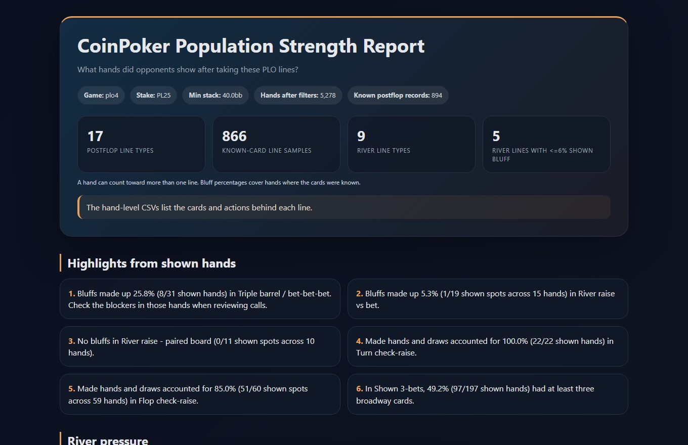

# CoinPoker Population Strength Analyzer - BETA

Shows what opponents held when they bet or raised in each CoinPoker PLO betting line, including how often a river raiser showed the nuts.



## Example findings (included 10,000-hand sample)

- **Triple barrel.** Cards were known for **52 of 117** eligible river bets. Of the hands shown, **26.9%** were practical nuts and **9.6%** were one pair or worse.
- **River raise without a prior check.** Cards were known for **21 of 69** eligible raises. Of the hands shown, **47.6%** were practical nuts and **4.8%** were one pair or worse.

These figures come from a default run on the sanitized public sample. [Hand history](cash_example.txt) · [PL25 example report](examples/coinpoker_population_strength_sample_pl25.zip)

## Verification

- All **33 regression tests** pass. Run `python -m unittest discover -v` from the repository root.
- Run `python verify_public_sample.py` to check gross pots against hand summaries and independently verify showdown labels, exported best-five cards and river classifications.

## Quick demo

Requirements: **Python 3.9+** on Windows. The analyzer uses only the Python standard library.

1. Extract the Windows ZIP from the [latest release](https://github.com/Texonja/coinpoker-population-strength-analyzer/releases/latest), or clone the repository.
2. Double-click `run_population_strength_beta.bat`.
3. Each prompt shows **Press ENTER for default**. Press Enter to use the included defaults, or type your own value.

The default run uses:

```text
Input: cash_example.txt
Hero: Hero
Game: PLO4 regular only
Stakes: all
Min stack: 40bb+
Min distinct hands with known cards per line: 10
```

The BAT file opens the main report automatically when processing finishes:

```text
population_strength_report\population_strength_presentation.html
```

## Run on your own hand history

Double-click the BAT file and enter your own filename and Hero screen name when prompted, or run the script directly:

```powershell
python coinpoker_population_strength_analyzer.py --input "cash.txt" --hero YourHeroName --outdir population_strength_report --game-filter plo4 --min-stack-bb 40 --min-known 10
```

Useful filters include:

```text
--game-filter plo4|plo5|bombpot|all
--stake-filter PL25,PL50
--date-from YYYY-MM-DD
--date-to YYYY-MM-DD
--min-stack-bb 40
--min-known 10
--include-bombpot
--vs-hero
```

By default, the analyzer includes opponents at Hero’s table even after Hero folds. Use `--vs-hero` to focus on direct betting interactions with Hero.

## Main outputs

Open `population_strength_presentation.html` for the report.

- `population_strength_by_line.csv` and `preflop_population_by_line.csv` summarize postflop and preflop results. The corresponding `_hands.csv` files list the hands and actions.
- `line_card_coverage.csv` shows eligible and classified action counts, including lines with too few known hands for a strength table.
- `bombpot_population_by_line.csv` shows the joint hand-strength distribution across BombPot boards. `filters_applied.json` records the run settings and sample counts.

## How to read a line

Strength percentages use only **actions with disclosed cards on that line**, and coverage shows how many eligible actions had known cards. See the classification rules in the [methodology guide](docs/METHODOLOGY.md).

## Beta limitations

Hand histories disclose a selected subset of opponent cards. These reports describe observed wagers and shown hands in the imported sample. Player intent, population-wide bluff rates and unknown holdings cannot be recovered from these data. New CoinPoker export formats may require parser updates.

[Changelog](CHANGELOG.md) · [Methodology and sample preparation](docs/METHODOLOGY.md)

This repository has no license.
